<p align="center">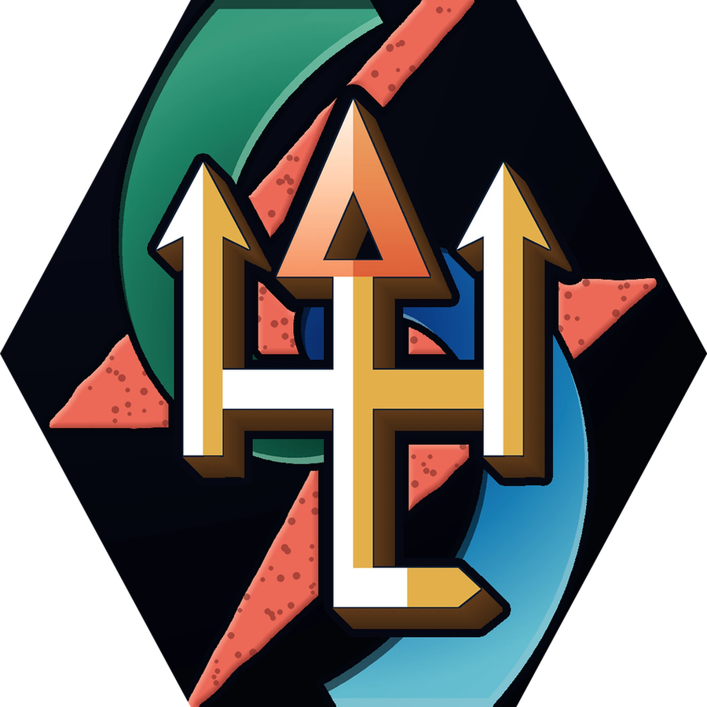</p>

# COMBAT ROGUE · LEVEL 1 → 30
### WoW Forever Beta · 10-slide pro-esports leveling deck

[](https://talents.standards.gg/rogue/000000000000000003200331120141)
[](https://talents.standards.gg/rogue/000000000000000003200332110141)

> **PVP** build = hybrid PVE + PVP · **PVE** build = pure leveling. Both are 0/21/0 Combat. Full PDF: [`Combat-Rogue-1-30.pdf`](Combat-Rogue-1-30.pdf)

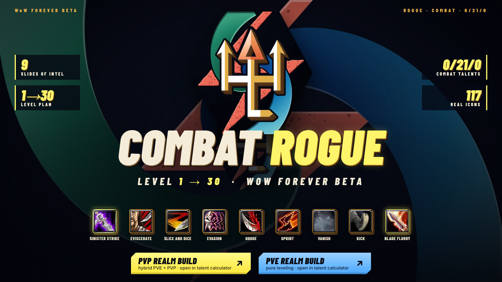

| # | Slide | What's inside |
|---|-------|---------------|
| 01 | Cover | The kit at a glance, PVP / PVE build links |
| 02 | [Talent Builds](png/02-talent-builds.png) | Both 0/21/0 trees, point-by-point talent order 10 → 30, the PVP Sprint / Endurance swap |
| 03 | [Rotation & Buttons](png/03-rotation.png) | Core loop, Lv 1–25 / 26+ / 30 rotations, the OH NO! panic buttons |
| 04 | [Level Plan](png/04-level-plan.png) | Class trainer abilities for every level 1 → 30, colour-coded must / good / skip |
| 05 | [Poisons · Weapons · Stats](png/05-poisons-weapons-stats.png) | Poison picks, main hand vs off hand, stat values, hit caps, gear example |
| 06 | [Dungeon Weapons](png/06-dungeon-weapons.png) | Every dungeon with level range and weapon drops (Horde quest items in red) |
| 07 | [Races](png/07-races.png) | Alliance + Horde ranked for rogues, racials with icons |
| 08 | [Professions](png/08-professions.png) | S → D tier list with camp bonuses and the Skinning → Leatherworking path |
| 09 | [Macros & Trainers](png/09-macros-trainers.png) | Copy-paste macros, weapon trainer locations and coordinates |
| 10 | [After 30](png/10-after-30.png) | Trainer plan 32 → 60 (buy your mount at 40) |

## Slides

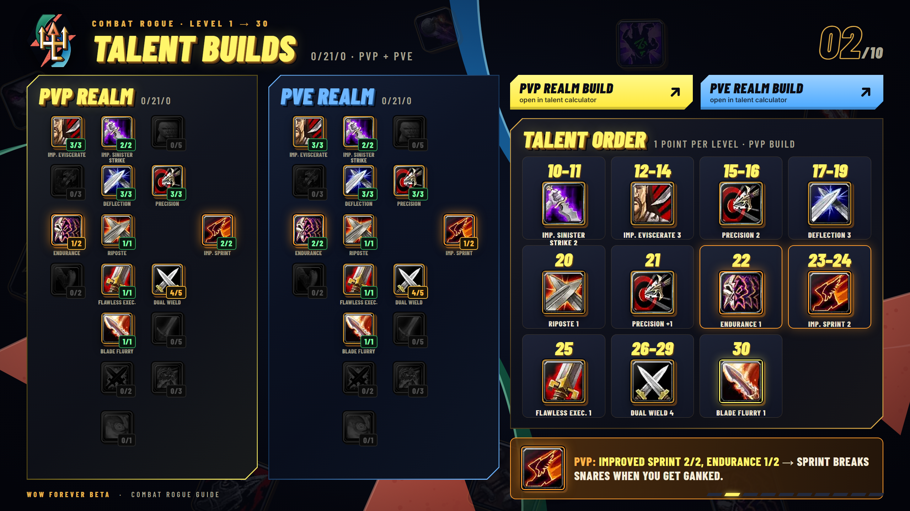
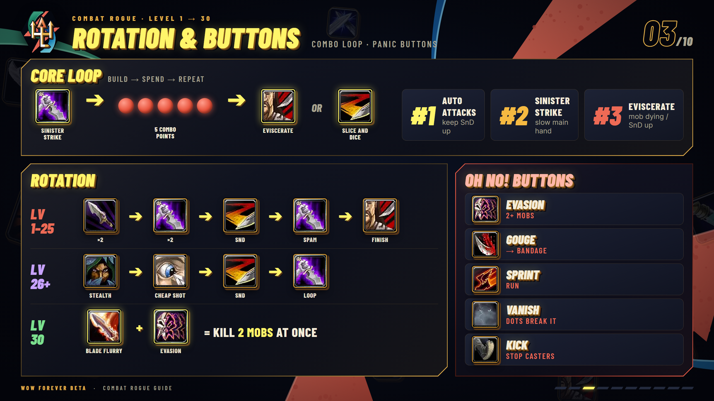
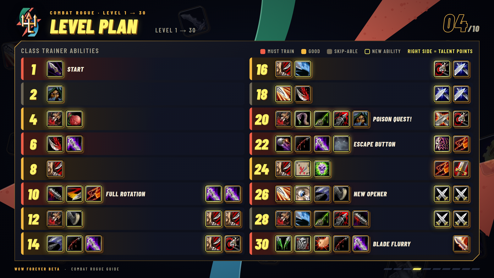
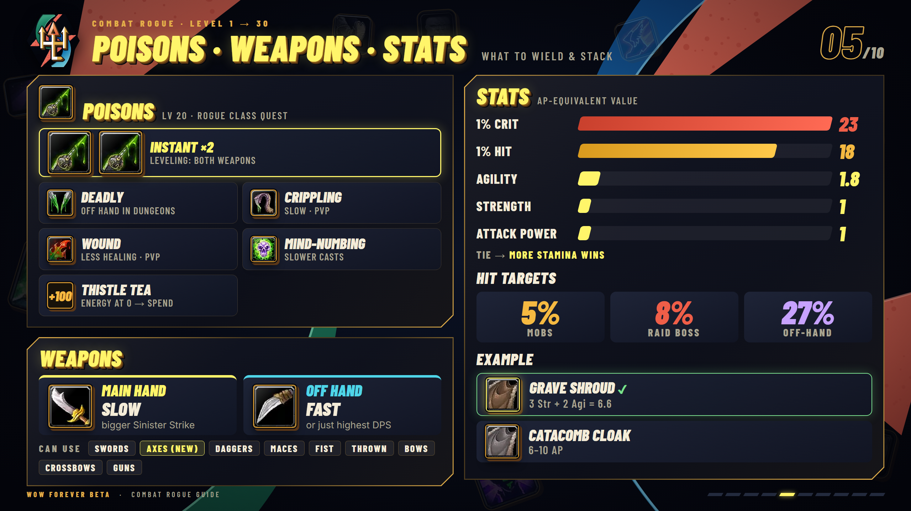
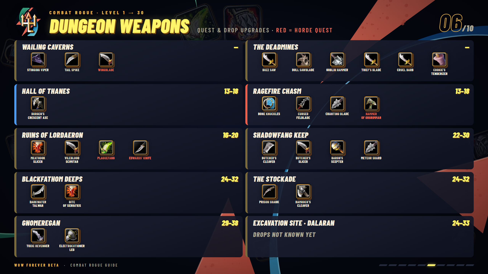
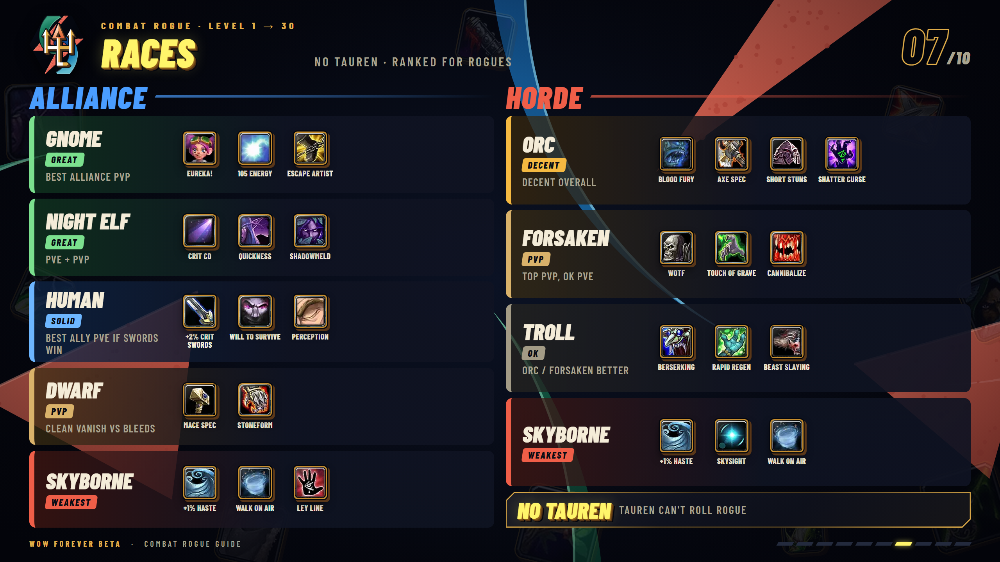
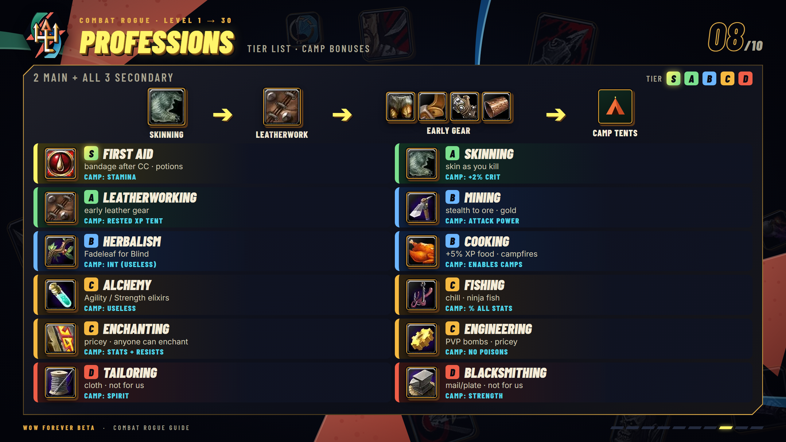
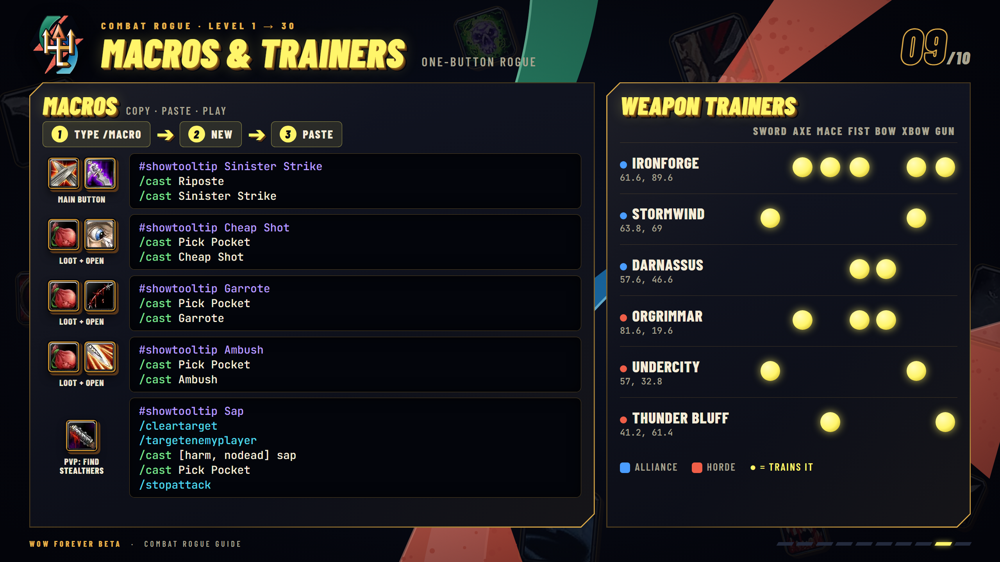
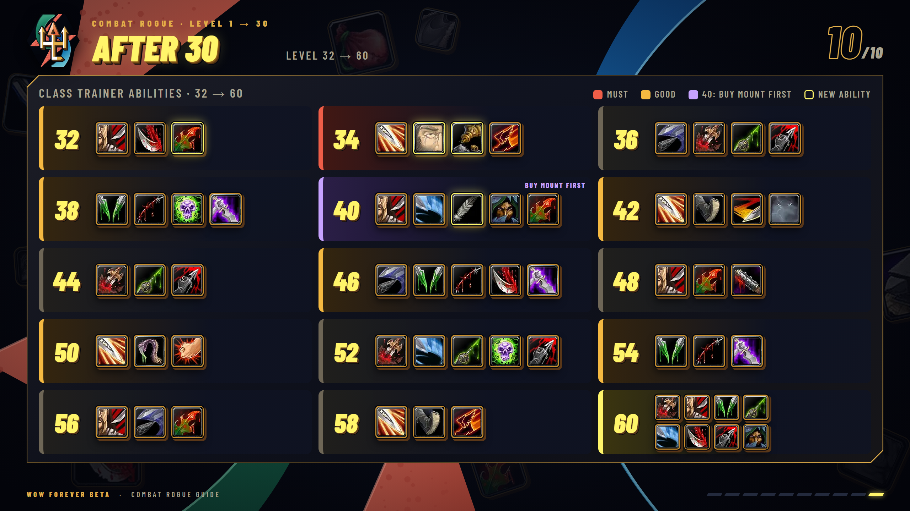

## Hover tooltips

In the web version (`index.html` or any slide HTML) hover any icon for its in-game tooltip:

- **Abilities, poisons, professions, Thistle Tea:** Blizzard's WoW Forever client data (product `wow_classic_beta`, build 1.60.1.70338) via wago.tools. Level plan and After 30 icons show the exact rank the trainer teaches at that level, with cost, range, cast time, cooldown and the description.
- **Talents and racials:** the [Standards.gg talent calculator](https://talents.standards.gg) data. Talent icons on slides 2 and 4 show the rank the build has at that point, with the next rank.
- **No tooltip yet:** the dungeon weapons, the two cloaks, the weapon examples, the early gear and the Camp Tent. Item stats are served by the game server and are not in the client tables.

`python scripts/build_tooltips.py` regenerates `data/tooltips.json` (needs the DB2 CSVs from wago.tools in `$DB2_CACHE`, plus the forevertalent data; see the script header).

## Rebuild

Slides are plain HTML/CSS at 1920×1080 (`slides/*.html`), generated by `build.py` from the icon data in `src/`.

```bash
python build.py     # writes slides/*.html
python render.py    # renders png/*.png at 2560x1440 (needs Microsoft Edge; edit EDGE path in render.py)
```

Open `index.html` to page through the deck, or any `slides/NN-*.html` on its own. Icons are in `assets/ic/` (upscaled 4× from the 64 px originals), fonts are bundled in `assets/fonts/`.

## Credits

Game icons and names are property of Blizzard Entertainment; this is an unofficial fan guide.
